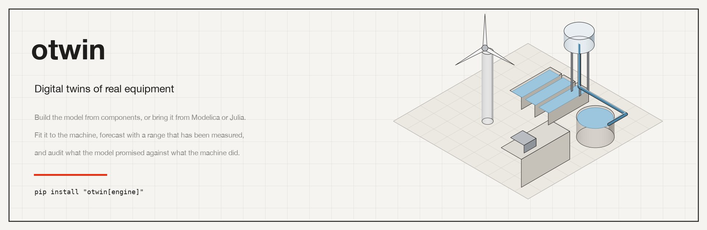

<div align="center">



<br>

[](https://github.com/otwin-core/otwin/blob/main/LICENSE)
[](https://pypi.org/project/otwin/)
[](https://crates.io/crates/otwin-core)
[](https://scorecard.dev/viewer/?uri=github.com/otwin-core/otwin)
[](https://api.reuse.software/info/github.com/otwin-core/otwin)

</div>

## What Otwin is

Otwin builds digital twins of real equipment: a battery container, a pump
station, a reactor, a drivetrain. You describe the equipment as components and
connections, the way its drawing reads, and Otwin writes the equations, runs
them, and keeps an energy account you can check at every step. Then it does
the part that comes after a model exists and is connected to one real machine:
it fits the parameters the data can determine and says which ones it cannot,
it forecasts with a range whose coverage has been measured on data the model
never saw, it audits what the model promised against what the machine did, and
it refuses to answer when it has no basis to. Models built elsewhere, in
Modelica or Julia, enter the same workflow as forecast functions.

## How it works

**Components and connections.** Every domain uses two variables at a port: an
across variable shared at a connection (voltage, velocity, pressure,
temperature, concentration) and a through variable that sums to zero there
(current, force, flow, heat flow, molar flow). A component is a small set of
relations between the two on its ports: a storage, a dissipation, a source, a
coupling. The library has them for electrical, mechanical, rotational,
hydraulic, thermal and chemical systems, plus devices built from them (a
battery, a pump, a DC motor, a stirred reactor), and six fundamental elements
for anything the library does not name.

```python
import otwin
from otwin.components.hydraulic import Tank, Pump, Pipe, Atmosphere

reservoir, tower = Tank(400.0, level=3.0, name="reservoir"), Tank(300.0, level=2.0, base_elevation=30.0, name="tower")
pump, main, atm = Pump(shutoff=4.6e5, max_flow=0.13, name="pump"), Pipe(friction=8e6, name="main"), Atmosphere()
system = atm >> reservoir >> pump >> main >> tower            # the line, as the drawing reads
model = otwin.compile(system)                                  # the equations, in port-Hamiltonian form
run = model.simulate(t_span=(0, 3600), dt=10.0)
print(run["tower.level"][-1], run.energy_balance()["max_violation"])
```

**The compiler.** `otwin.compile` turns the graph into a port-Hamiltonian
system: an energy function, an interconnection matrix that moves energy
without loss, a dissipation matrix that only removes it, and ports for the
inputs. That structure is what makes the energy account exact rather than
approximate, and it is why the compiler refuses a system it cannot account
for, in the language of components, rather than returning a model that is
quietly wrong. A Rust engine runs the compiled model; a NumPy backend gives the
same numbers without it.

**The twin.** Once the model is connected to measurements, four verbs do the
rest. `fit_parameters` fits the named parameters and reports whether the data
determined each one. `rolling_origin_residuals` and `horizon_conformal` turn
genuine out-of-sample forecast errors into a range that widens with the
horizon. `coverage_audit` checks, on days the model never saw and by horizon,
whether the stated coverage was delivered, with the bias and the width. An
`Envelope` reads the manifest of what was fitted, validated and calibrated,
and refuses questions outside it, naming the boundary. Tutorial 10 does all of
this on a water tower.

### Install

```bash
pip install "otwin[engine]"              # the library and the Rust engine
pip install "otwin[engine,tutorials]"    # plus seaborn and pandas, for the tutorials
```

Python 3.10 or later. Without `engine`, every model runs on the NumPy backend,
more slowly and with the same results. Optional extras add field connectors
(`modbus`, `sunspec`, `opcua`), learned residuals (`nn`) and Gaussian-process
intervals (`gp`).

### What to keep in mind

- **Units are SI and strict.** Pressures in pascals, temperatures in kelvin,
  amounts in moles. A `Tank` level is metres and its state is cubic metres; a
  battery capacity is ampere-hours. The compiler reports every parameter with
  its unit, and the field connectors refuse a unit they do not know.
- **Sources with `None` are inputs.** A `VoltageSource(None)` or `Dose(None)`
  becomes an input of the compiled model, supplied at simulation time as a
  number, an array, a function of time, or a function of time and state.
- **Two pins on one node is an error.** Two capacitors in parallel, two
  inertias on one shaft, or a flow-setting element in series with another with
  only a resistor between them, leave a potential the network cannot
  determine. The compiler says so and names the ports; put a resistor or a
  small storage between them.
- **Read the representation line.** `port-hamiltonian` means the energy audit
  is a first-law statement. `pseudo-port-hamiltonian` (thermal, chemical,
  heat from losses) means the balances are exact but temperature times heat
  flow, or concentration times molar flow, is not a power.
- **Chemistry runs with `solver="patankar"`,** which keeps every amount
  non-negative and every mass balance exact at any step size. The general
  integrators do neither when the step is large against the fastest reaction.
- **A forecast range is calibrated on out-of-sample errors**, never on fitting
  residuals, and it is only trustworthy after the audit on held-out data says
  so. The envelope exists so that the twin can say no.

## Tutorials

Ten tutorials in the [`tutorials`](tutorials) folder cover every component in
the library, each on a real piece of equipment with its process diagram, the
engineering question, and the steps with their code, output and plots. The
same tutorials are notebooks in [`examples`](examples), run by the test suite.

1. **[A battery energy storage container](tutorials/01_battery_energy_storage.md)**
   (energy storage). A 2 MWh LFP container through a day of dispatch: state of
   charge, voltage window and round-trip efficiency on the electrical side, and
   the cell temperature against the HVAC on the thermal side, joined by the I²R
   losses.
2. **[A DC distribution feeder](tutorials/02_dc_distribution_feeder.md)**
   (energy distribution, electrical). A 750 V feeder with its cable, DC link and
   an ideal converter to a 48 V bus. A load step rings at the LC frequency; the
   energy balance closes; a cable sweep prices copper against losses.
3. **[A vehicle suspension](tutorials/03_vehicle_suspension.md)** (mechanical).
   A quarter-car over a bump at 36 km/h: body acceleration, suspension travel
   and tyre force, then a sky-hook damper to a fixed frame, the reference every
   active suspension is measured against.
4. **[A wind turbine drivetrain](tutorials/04_wind_turbine_drivetrain.md)**
   (mechanical, energy). Rotor, torsional main shaft, a 1:90 gearbox as a
   transformer and a grid-locked generator with slip damping. A gust shows the
   torsional mode and its damping; the gearbox moves power without loss.
5. **[A municipal water supply](tutorials/05_water_supply.md)** (hydraulics,
   civil). Reservoir, pump station, filter, rising main and elevated tank
   against a day of demand. Then a fouled filter and a leak, which look alike on
   the level trace, and Torricelli's law checked by hand.
6. **[Wastewater disinfection](tutorials/06_wastewater_disinfection.md)**
   (chemical, environmental). A chlorine contact tank as a train of stirred
   cells: first-order decay and second-order demand, the dose that meets the
   permit, a storm flush, and why chemistry runs with the `patankar` solver.
7. **[A heated building](tutorials/07_heated_building.md)** (thermal, building
   services). An electric boiler whose losses heat a water loop, radiators, a
   room, an envelope and ventilation on a cold day with a night setback; where
   the heat goes and what insulation would save.
8. **[A motor-driven pump](tutorials/08_motor_driven_pump.md)**
   (electromechanical, hydraulic). A DC motor composite, a gear pump as a
   gyrator between rotation and hydraulics, a line and a head tank: inrush,
   start-up and the efficiency chain from the terminals to the water.
9. **[A flywheel energy store](tutorials/09_flywheel_storage.md)** (energy
   storage). The same device from the six fundamental elements alone, with the
   domain as an argument: capacity, self-discharge against its closed form, a
   100 kW round trip and the first-law audit.
10. **[From a model to a digital twin](tutorials/10_from_model_to_twin.md)**
    (the twin workflow). A component of your own, a composite, a fit with an
    identifiability verdict, a forecast range calibrated on out-of-sample errors,
    an audit by horizon on unseen days, and an envelope that answers or refuses.

## Beyond Python

[`julia/Otwin.jl`](julia/Otwin.jl) wraps this implementation through
PythonCall, with Julia types in and out. The normative specification and the
conformance suite that judge any implementation live in
[otwin-spec](https://github.com/otwin-core/otwin-spec), with a Julia judge that
agrees with the Python runner check by check. The full documentation is at
[otwin.readthedocs.io](https://otwin.readthedocs.io/).

## Licence

Apache-2.0. See [LICENSE](LICENSE) and [NOTICE](NOTICE).
