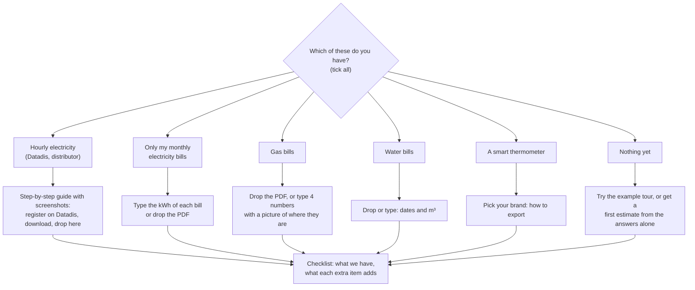
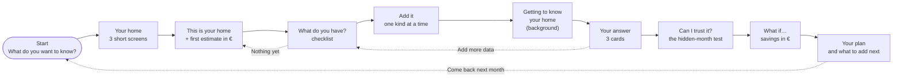
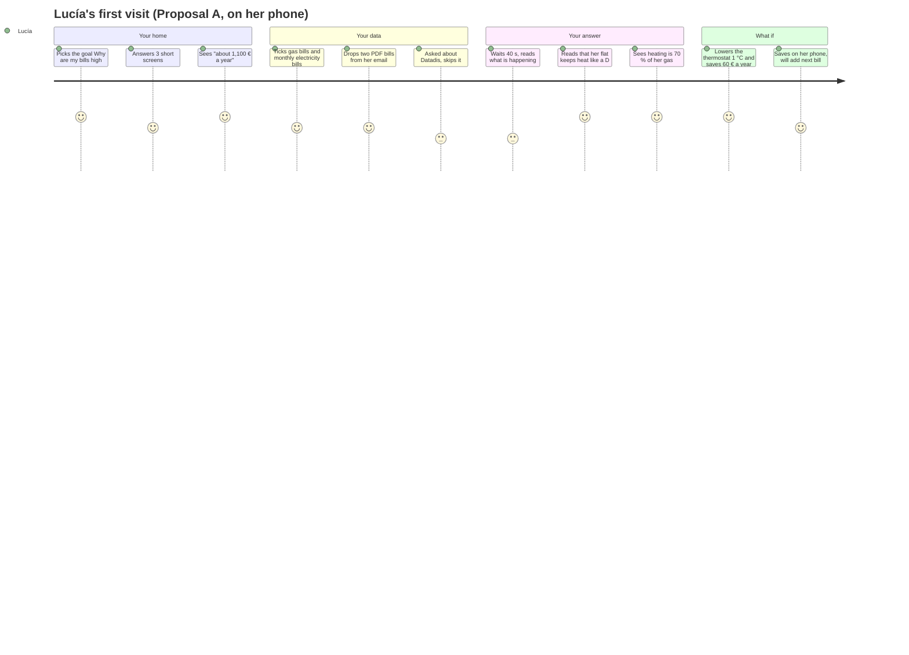
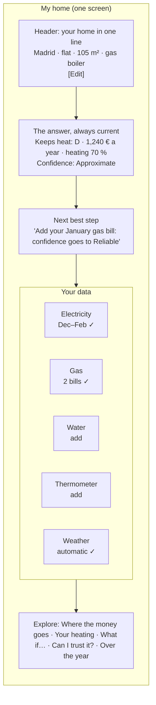
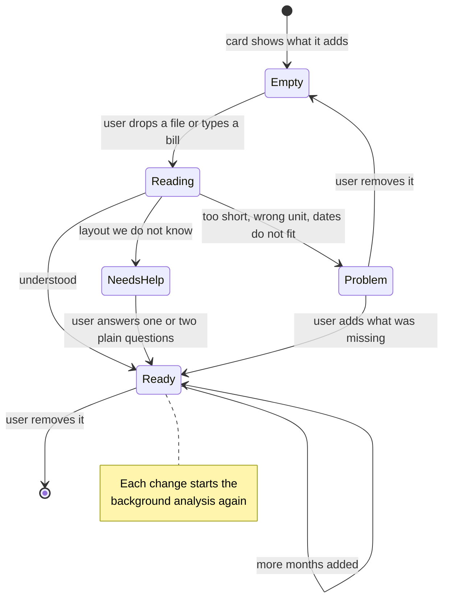
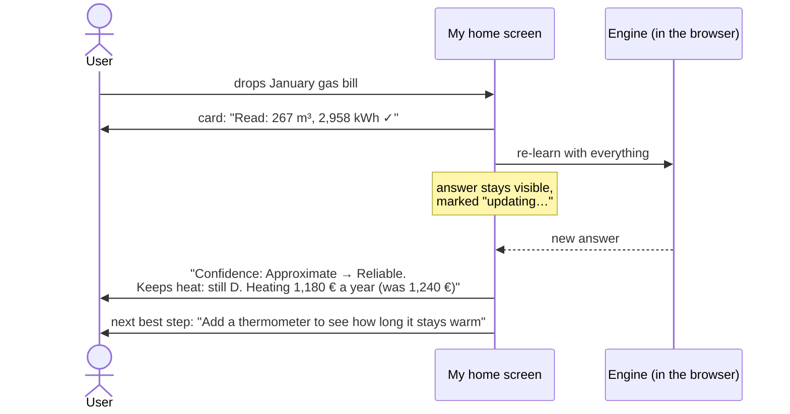
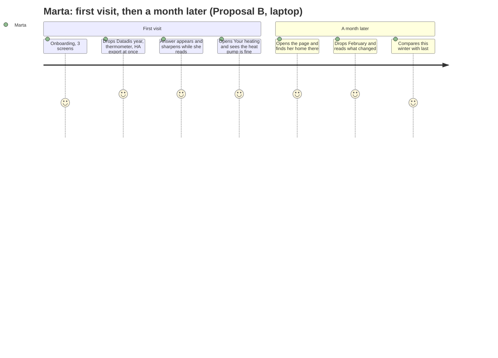
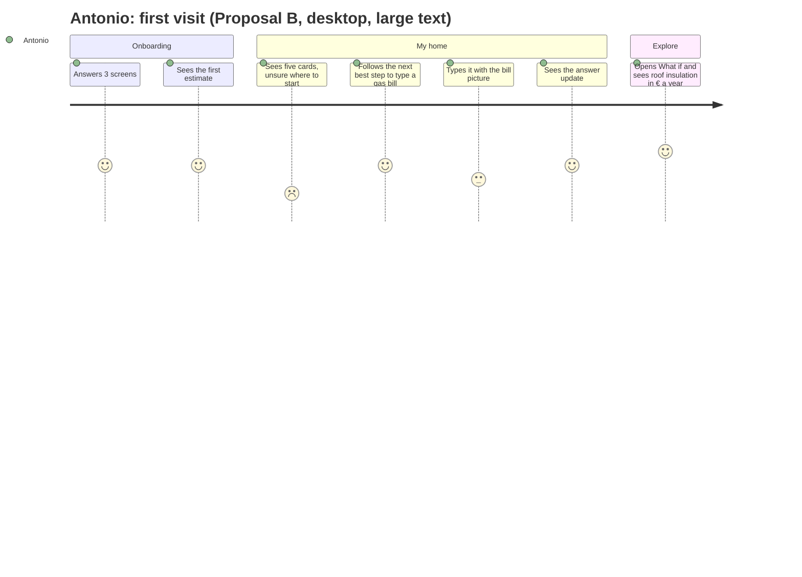

# Otwin Home: two proposals for the user workflow

Status: **proposal B, "My home", is what the page does now** (November 2026),
with one change that use made necessary: it is split into four sections
(Your home · Demo · Simulation · Help), so a demo home never sits inside
the householder's own. Proposal A is kept here as the road not taken, and
the principles in §3 hold for both.

What follows was written before either was built. Nothing in it is a
promise about what exists today. This document describes how a person moves
through the application, not how it is coded.
Where a proposal needs work the engine does not do today, that is said, and
it is not a reason to drop the proposal: **the user comes first, the code
follows.**

The diagrams are [Mermaid](https://mermaid.js.org/); GitHub and VS Code's
Markdown preview draw them.

---

## 1. Who we design for

The target user is the **general public**, not an engineer. Three people
stand for them throughout this document:

| | Lucía, 34 | Antonio, 68 | Marta, 45 |
|---|---|---|---|
| Home | Rented flat in Madrid, gas combi boiler | Detached house in Valladolid, gas boiler, electric *termo* | Flat in Valencia, heat pump, induction hob |
| Device | Mobile phone, sometimes a laptop | Desktop computer, large text | Laptop |
| Data she or he has | PDF bills by email; has never heard of Datadis | Paper bills in a folder | Datadis account, a Xiaomi thermometer, Home Assistant |
| What they want to know | "Why is my gas bill so high? Is it the flat or me?" | "Is it worth insulating the roof?" | "Is my heat pump working as it should?" |
| What makes them leave | A form that asks for things she does not have | Small text, technical words, anything that looks like it can break | Being slowed down by explanations she does not need |

What they share: **they do not know what a W/K, a time constant, a PCS or a
calibration is, and they should never need to.** They know euros, kWh (from
their bills), degrees, months, and their own home.

### What people come to do (jobs to be done)

1. **Understand** my home: where my money goes and whether my home is
   "good" or "bad" at keeping heat.
2. **Decide**: what would I save if I lowered the thermostat, insulated,
   changed tariff or moved the dishwasher to the night?
3. **Trust**: is this believable, or a toy?
4. **Come back**: next month, next winter, after the works, and see if
   it changed.

Every screen in both proposals has to serve at least one of these four.

---

## 2. Where today's page hurts

What we learnt from building and clicking through the current three-step
wizard (*Your home → Your data → Calibration*):

| Where | What happens | Why it hurts the user |
|---|---|---|
| Step 1 | Twelve questions on one long page | Feels like a form to fill in, not a conversation; the useful summary ("This is your home") is at the bottom, below the fold |
| Step 2 | Drop zone, bill form, five example buttons, file list and status messages share one screen | No clear "what do I do now"; the most important message (what is missing) is mixed with what is fine |
| Step 2 | Getting hourly electricity needs a Datadis account | The hardest task of the whole application is mentioned in one line, with no help |
| Step 2 | A file in an unknown layout opens the column mapper ("which column is the time?") | Technical; most people stop here |
| Step 2 | The weather is a "file" to add | People do not have weather files and should not need to know the twin uses the weather |
| Step 3 | The word **calibration**, a period chooser, "compare the periods" | Engineering vocabulary and decisions a householder cannot make |
| Step 3 | A 30 s to 90 s wait with a counter | Acceptable today; with a year of data it will be minutes, and the page is blocked |
| Report | Verdict, headline, gas, water, five findings, charts in one long column | The answer to "so what?" is not on top; numbers come before meaning |
| Report | Findings in W per °C, kW, hours of time constant | Correct, but not the user's units |
| Everywhere | English only | Our users are in Spain |
| Everywhere | Nothing is remembered: reload the page and everything is gone | People cannot come back next month |
| Examples | The example home looks like real data and mixes with the user's own files | Confusing: "are these my numbers?" |

---

## 3. What both proposals share

These rules hold whichever workflow is chosen.

### 3.1 Words

| We say today | The user reads |
|---|---|
| digital twin | **"your home's model"** at first; "twin" only once explained |
| calibration, fit | **"getting to know your home"**; the button says *Analyse my home* |
| good / usable / not enough data | **Reliable / Approximate / We need more data**, always with what to do next |
| heat loss, W per °C | **"How well your home keeps the heat"**, on an A–G scale like the energy certificate (see 3.4) and in euros |
| time constant, heat storage | **"How long it stays warm when the heating goes off"**, in hours |
| boiler size, kW | **"Your boiler is big enough / too small / bigger than needed"** |
| always-on load, W | **"What stays on all the time"**, in € a year |
| thermometer offset | not shown unless asked: "your thermometer reads 0.3 °C high" |
| period, record, spin-up | never shown |
| Fc, PCS | shown only on the bill-typing screen, with a picture of where they are on the bill |
| validation on unseen data | **"Test: we hid one month from the model, then asked it to guess"** |

### 3.2 Rules

1. **One thing per screen**, one main button, visible without scrolling on a
   phone.
2. **Always say what is next**, and why it helps ("Add a gas bill: it shows
   how well your walls keep the heat").
3. **Never block.** Missing data lowers precision; it does not stop the user.
   The result says what more data would add.
4. **Results first, details on demand.** The answer in one sentence, then
   three cards, then "How do we know?" for the curious.
5. **Euros and comparisons before physics.** "Your flat loses heat like a
   typical 1970s flat: 1.1 heaters running all winter just to keep up."
6. **Privacy is visible and constant.** "Your files never leave this
   computer" on every screen with files; the one outside request (weather) is
   asked for, once, in plain words.
7. **Waiting is never dead time.** Long work runs in the background with a
   plain-words progress ("Trying different versions of your home… 40 of
   about 100"), and the user can keep reading or answering.
8. **Remembered on this device.** The home and its results are kept in the
   browser (never uploaded) so the user can come back; one button deletes
   everything.
9. **Examples are a guided tour**, clearly marked as such ("You are looking
   at Ana's example flat"), with a single exit, never mixed with own data.
10. **Spanish first** (then English, Catalan, Basque, Galician), large text
    option, keyboard and screen-reader friendly, works on a phone.
11. **Errors are help, not failures.** "This file is from i-DE but covers
    only 9 days. Download at least one month: here is how."

### 3.3 Getting the data must be the easiest part, not the hardest

Both proposals replace "drop your files" with **"what do you have?"**:

Consequences for the engine (not reasons to stop):

- **Weather is fetched automatically** for the province and the dates of
  the data, after one consent ("We will ask Open-Meteo for the weather in
  Madrid for these dates. Only the place and the dates are sent."). The
  weather file and the column mapper stay only under "Other files".
- **Monthly electricity bills** must be accepted as a lower-precision
  alternative to hourly data. *New engine work*: bill-interval electricity,
  the same form gas bills already use.
- **PDF bills** (Naturgy, Endesa, Iberdrola, TotalEnergies, Repsol, the
  regulated tariffs) read in the browser. *New work*.
- **A first estimate from the answers alone**, before any data: "A home
  like yours typically spends 900–1,300 € a year on heating." *Uses what the
  survey already builds.*

### 3.4 Showing the answer

- **A–G scale for how well the home keeps the heat**, coloured like the
  energy certificate everyone in Spain has seen, computed from the fitted
  heat loss per m². It must say clearly *it is not an official certificate*.
  The thresholds need checking against the certificate's own scale.
- **€ per year** for everything that can be priced: heating, hot water,
  cooking, always-on, each what-if.
- **"Compared with similar homes"**: same type, size, age and climate.
- **Confidence shown once, simply**: a three-step bar (Reliable /
  Approximate / Need more data) and "How do we know?" for the detail.
- **The test on hidden data** (next step of the project) is the strongest
  argument for trust, so it is shown as a result, not hidden in a report:
  "We hid February. The model guessed 1,940 kWh of gas; your bill says
  1,965. **1 % off.**"

---

## 4. Proposal A: "Step by step" (a guided conversation)

### 4.1 The idea

The application talks to the user like a good energy advisor on a first
visit: **one question at a time, in a fixed order, always knowing what
comes next**, and ends with an answer and a plan. Nothing to decide about
where to go. It is today's wizard, rebuilt around the user's questions
rather than around the engine's steps.

### 4.2 The path

Progress is a bar of five named stops: **Your home · Your data · Your answer
· Can I trust it? · What if**. The user can go back to any stop already
visited, never jump forward past what is missing.

### 4.3 Screen by screen

| # | Screen | The user sees | The user does | Notes |
|---|---|---|---|---|
| 0 | **Start** | "Understand your home's energy, privately, in your browser." Three goals: *Why are my bills high?*, *What can I save?*, *Is my heating OK?* | Picks a goal, or *Try with an example* | The goal reorders the results later (savings first, or diagnosis first) |
| 1a | **Where and what** | Province, kind of home, size | 3 taps | Big tiles with icons |
| 1b | **How you heat** | Heating, hot water, cooking, air conditioning | 4 taps | Combinations allowed; pictures of a combi boiler, a *termo*, a *calentador* |
| 1c | **How you live** | People, thermostat by day and at night, appliances | Sliders and tiles | "Not sure" is always an answer |
| 2 | **This is your home** | The summary in plain words + **first estimate**: "A home like yours spends about 1,100 € a year on energy, 60 % of it heating" | *Looks right* / *Change something* | The user gets value before giving any file |
| 3 | **What do you have?** | The checklist of 3.3, each item with "what it adds" | Ticks what they have | Hourly electricity is shown as *best*, not *required* |
| 4 | **Add it** | One kind of data per screen, with its own guide | Drops a file, types a bill, follows the Datadis guide | Each file read is confirmed in one line ("31 days of electricity, 1 Dec to 31 Dec, 242 kWh ✓"); problems say what to do |
| 5 | **Getting to know your home** | A short animation of the house and plain progress; the questions the analysis will answer | Waits, or reads "what we are doing" | Runs in the background: a year of data can take minutes. The user can go back and edit answers; it restarts |
| 6 | **Your answer** | One sentence + three cards: *how well it keeps the heat* (A–G), *where your money goes* (€), *your heating* (works fine / oversized / struggles) | Opens "How do we know?" if curious | The goal chosen at start decides which card is first |
| 7 | **Can I trust it?** | The hidden-month test, as a chart: the model's guess against the real bill for a month it never saw | Reads it | Only when there is more than one month; otherwise "Add another month to run this test" |
| 8 | **What if…** | 4 or 5 levers, each with € per year: thermostat −1 °C, insulate roof/walls/windows, night setback, cheaper tariff, move the washing machine | Moves sliders, compares | Uses the scenarios engine that already exists |
| 9 | **Your plan** | The 2–3 changes with the best € per year, what more data would sharpen the answer, *Save on this computer*, *Download a report (PDF)* | Saves, prints, or leaves | The report is something Antonio can show his family or an installer |

### 4.4 The first visit, as Lucía lives it

### 4.5 More data and the hidden-month test (the next steps)

- **6 months or a year**: the checklist simply counts what is there ("4 of
  12 months"); the analysis uses everything without asking the user to pick
  periods. The answer screen adds a **year view**: twelve bars, real against
  model, heating months highlighted.
- **The hidden-month test** is its own stop in the path (screen 7), so every
  user meets it. It runs automatically when there are at least two months:
  the model learns from all months but one and guesses that one; repeated
  for each month if time allows.
- **Prediction** ("what will next winter cost?") belongs to *What if…* as
  "Next winter, same habits", with the uncertainty as a range in euros.

### 4.6 Coming back

The start screen recognises a saved home: **"Welcome back. Add your new
bill?"** goes straight to step 4 with the right kind of data pre-selected,
then to the answer, showing what changed since last time.

### 4.7 Pros

- **Nobody gets lost.** There is always exactly one next thing to do; ideal
  for Antonio and for anyone on a phone.
- **Value before effort.** The first estimate (screen 2) arrives before any
  file, which keeps people going through the hardest part (getting data).
- **Trust is built in order**: answer, then evidence (the hidden-month
  test), then what to do. Everyone sees the test.
- **Easy to explain, test and measure**: each stop can be timed and its
  drop-off counted.
- **Close to today's page**: the engine calls stay the same; much of the
  change is in screens and words.
- **Natural fit for a printed report** ("Your plan").

### 4.8 Cons

- **Slow for experts and returning users.** Marta has to walk the path to
  change one answer or add one file. "Welcome back" shortcuts soften it but
  add special cases.
- **Linear thinking about data.** People find bills over days; a path
  implies "finish now". Saving progress is essential, or they lose
  everything when they stop to look for a bill.
- **Changing an early answer after the analysis** means re-running it and
  walking forward again; it must feel instant, which needs background work
  and caching.
- **More screens** (around ten) for the same information: more to translate
  and keep consistent.
- **The what-ifs come last**, so impatient users may never see the most
  useful part.

---

## 5. Proposal B: "My home" (a living dashboard)

### 5.1 The idea

The application is **a picture of your home that gets sharper as you add
things**. One main screen, the home, surrounded by its data sources as
cards. The model learns automatically every time something is added or
changed; the answer is always visible and always current. There is no
"finish": the user adds what they have, when they have it.

### 5.2 The layout

The first visit is a short **onboarding** (the three "your home" screens of
Proposal A, plus the first estimate) that ends on this screen. From then on,
**this screen is the application.**

### 5.3 A data card's life

Every data source behaves the same way, so learning one teaches all:

### 5.4 What happens when the user adds something

The user never presses *Analyse*: adding data **is** the action. A small
"what changed" note after every update makes the effect of each addition
visible, which rewards adding more.

### 5.5 The explore areas

| Area | What the user finds | Engine |
|---|---|---|
| **Where the money goes** | Heating, hot water, cooking, always-on, appliances, in € a year and as a picture of the house | Twin outputs, tariffs |
| **Your heating** | A–G scale, how long it stays warm, boiler fit, the thermostat's day (on/off, % of time running), the indoor temperature against the model's | Calibration findings, thermostat outputs |
| **What if…** | The levers of Proposal A, side by side, with € per year; "next winter, same habits" | Scenarios |
| **Can I trust it?** | The hidden-month test, the confidence bar and why, what more data would add | Validation (next step) |
| **Over the year** | Twelve bars real against model; seasons; how this year compares with last | Long records (next step) |

### 5.6 Marta's and Antonio's visits

Antonio's dip (score 2) is this proposal's main risk: an open screen can
intimidate. The **"Next best step"** banner exists to answer it, and has to
be impossible to miss.

### 5.7 More data and the hidden-month test

- **A year of data fits naturally**: cards just say "Dec 2024 – Nov 2025 ✓";
  "Over the year" appears when there is enough. The model re-learns in the
  background; with a year that may take minutes, during which the old answer
  stays on screen, marked "updating…".
- **The hidden-month test** runs automatically after each update when there
  are at least two months, and feeds the confidence bar. Its detail lives in
  "Can I trust it?".
- **Prediction** is a lever in "What if…" ("next winter, same habits") and
  a line on the "Over the year" chart extending into the coming months.

### 5.8 Pros

- **Matches how people really collect data**: a bill today, Datadis next
  week, a thermometer next month. Nothing is ever "unfinished".
- **The answer is always on screen** and visibly improves with each
  addition, which is the best motivation to add more data.
- **Built for coming back**: monthly bills, comparing winters, before/after
  works. It is the natural home for 6-month and 1-year data and for
  long-term prediction.
- **Fast for experts**: Marta drops everything at once and explores.
- **No "analyse" button, no wait screen**: the engine works in the
  background, the user never stares at a counter.
- **Each area can grow** (a new data source is one more card; a new
  question is one more explore area) without redesigning the flow.

### 5.9 Cons

- **An open screen can overwhelm** first-time and less confident users
  (Antonio). It depends heavily on the "Next best step" and on good empty
  states.
- **Less guaranteed exposure**: users may never open "Can I trust it?",
  so trust has to come from the confidence bar alone.
- **Harder to build well**: continuous background re-analysis, cancelling
  stale runs, "what changed" summaries, saving state, all of it in a
  browser tab. *New engine work*: incremental or cancellable runs, a
  result cache.
- **Harder to test and measure**: no single path, so "where do people give
  up?" needs more careful observation.
- **More layout work on phones**: a dashboard has to collapse into a
  sensible single column without losing the answer at the top.
- **Answers that change under the user's eyes** need care: if a new bill
  moves the A–G letter from D to E, the user must see why.

---

## 6. Side by side

| | A · Step by step | B · My home |
|---|---|---|
| Mental model | A conversation with an advisor | A picture of my home that sharpens |
| First visit | Guided from start to plan | Short onboarding, then free |
| Who it suits best | First-timers, low confidence, phones (Lucía, Antonio) | Returning users, experts, people with lots of data (Marta) |
| Getting lost | Almost impossible | Possible; mitigated by "Next best step" |
| Adding data over weeks | Needs "save and continue later" | Natural |
| Seeing the effect of more data | At the end of each pass | Immediately, with "what changed" |
| Trust (hidden-month test) | Everyone sees it (a stop in the path) | Behind a tab; summarised in the confidence bar |
| What-ifs | At the end, may be missed | Always one tap away |
| 6 months / 1 year | Fits, as "more of the same" | Fits naturally, "Over the year" area |
| Coming back next month | Shortcut from the start screen | Opens straight on the home |
| Waiting for the analysis | A dedicated screen (background) | Never: the old answer stays, "updating…" |
| Change from today's code | Moderate: mostly screens and words | Large: background re-analysis, state, cache |
| Risk | Boring for experts; drop-off on long paths | Overwhelming for novices |
| Easiest to test with users | Yes: a fixed path | Harder: open exploration |

---

## 7. How to choose

Neither proposal should be chosen on paper. A suggested way:

1. **Clickable prototypes of both**, in Spanish, with the example home (no
   engine needed: canned results), on a phone and on a laptop.
2. **Five to eight people per proposal** who match the three profiles,
   given the same three tasks:
   - "Find out how much of your gas goes to heating."
   - "Add a second bill you have just received."
   - "Find out what lowering the thermostat by one degree would save."
3. **Measure**: tasks completed without help, time to the first useful
   answer, words they did not understand (note every one), and whether they
   can explain in their own words *how sure* the result is.
4. **Watch especially** Antonio-like users on B's main screen and
   Marta-like users on A's ninth screen.

A combination is also possible and worth testing as a third prototype if
both show clear strengths: **A's guided path for the first visit, ending on
B's "My home" screen for every visit after.** That keeps A's "nobody gets
lost" for newcomers and B's "always current" for everyone who returns, at
the cost of building both.

---

## 8. Open questions

- **Spanish wording** of the key words (*fiable / aproximado / necesitamos
  más datos*; *cómo de bien guarda el calor*) should be tested with users,
  not translated.
- **A–G scale**: which thresholds, and how to make clear it is not the
  official certificate without confusing people.
- **PDF bills**: which retailers first (by market share), and what to do
  when a PDF cannot be read (fall back to typing, with the picture).
- **Monthly electricity bills**: how much precision is lost against hourly
  data, and how to say so.
- **Saving on the device**: how long, how to warn before the browser clears
  it, and whether to offer an encrypted file export.
- **Long analyses** (a year of data): how long they take in a phone
  browser, and whether a quicker first answer (from fewer months) should
  appear while the full one runs.
- **Several homes** (a second residence, a parent's home): one list of
  homes, or one home per browser?
