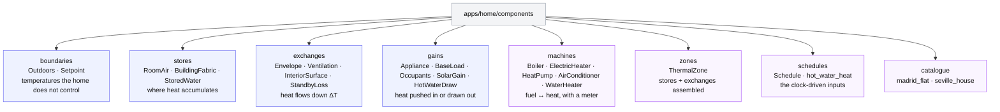

# Otwin Home components

## The map

One module per role, and every component plays exactly one role. That is all
a newcomer needs to place any component. The roles are the home-sized names
of Otwin's own six roles (see `COMPONENTS.md` at the repository root): a
`RoomAir` is to a house what a `Capacitor` is to a circuit, an `Envelope` is
a `Resistor`, an `Appliance` is a through source. The compiler sees only the
roles, so a home compiles into the same port-Hamiltonian form as a battery
or a pump station, and runs on the same engine.

## Roles

| Home role | Otwin role | Rule it obeys | Components |
|---|---|---|---|
| **Boundary** | across source | fixes a temperature, whatever flows | `Outdoors` (an input: the weather), `Setpoint` (a dial: parameter or scheduled input) |
| **Store** | across storage | `C dT/dt = Σ Q`; its temperature is the state | `RoomAir` (hours), `BuildingFabric` (days), `StoredWater` (litres) |
| **Exchange** | resistor | `Q = conductance × ΔT`, always downhill | `Envelope`, `Ventilation`, `InteriorSurface`, `StandbyLoss` — each conductance (W/K) a fittable parameter |
| **Gain** | through source | pushes heat in, no temperature of its own | `Appliance`/`BaseLoad` (**metered**: their heat is bought electricity), `Occupants`/`SolarGain` (**free**), `HotWaterDraw` (sign reversed: heat out) |
| **Machine** | composite (Setpoint + `Thermostat` law) | `Q = clip(P/band · ΔT, 0, P)`, fuel = heat moved / efficiency | `Boiler` (gas), `ElectricHeater`, `HeatPump` (COP), `AirConditioner` (EER, runs the law the other way), `WaterHeater` |
| **Zone** | composite | 1R1C or 2R2C RC network | `ThermalZone` |
| **Schedule** | model input | not physics: one value per local hour | `Schedule` (24 or 168 values), `hot_water_heat` |

Two distinctions carry the whole design:

1. **Metered or free.** Every gain heats the room, but only an `Appliance`
   shows on a bill, and only a machine's `fuel_power` does. The electricity
   meter is the sum of the `Appliance`s and the electric machines; the gas
   meter, of the gas machines. Occupants and sun are free heat, and leaving
   them out makes a fit blame the heating for heat it never supplied.
2. **Parameter or input.** What the house *is* (conductances, capacities,
   machine power, base load, setpoints) are parameters: symbolic, fittable,
   turnable in scenarios. What *happens* to the house (weather, appliance
   use, hot-water draws, setpoint schedules) are inputs: arrays over the
   grid, from a `Schedule` or from measured data read by `ingest`.

## The thermostat, and why a machine is a resistor

A thermostat-controlled machine delivers full power far from the setpoint
and less as it closes in; averaged over its on/off cycles that is

    Q = clip( (P / band) · ΔT, 0, P )

Read as heat flowing from a reservoir held at the setpoint into the target
(heating), or from the target into the reservoir (cooling), it is a monotone
law that only lets heat flow down its gradient — Otwin's *resistor* role —
so the engine needs nothing new, and both backends run it. The fuel meter is
the heat moved divided by the machine's efficiency: η ≤ 1 for a boiler on
the gross calorific value, a COP of 2.5-4 for a heat pump, an EER of 2.5-3.5
for air conditioning.

## What the compiler sees

| Component | Ports | Parameters (fittable) | Inputs | Outputs |
|---|---|---|---|---|
| `Outdoors` | `port` | — | `<name>` (K) | — |
| `Setpoint` | `port` | `<name>.temperature` (K) | `<name>` when scheduled | — |
| `RoomAir`, `BuildingFabric` | `port` | `<name>.capacity` (J/K) | — | `<name>.temperature` |
| `StoredWater` | `port` | `<name>.capacity` (J/K; from litres) | — | `<name>.temperature` |
| `Envelope`, `Ventilation`, `InteriorSurface`, `StandbyLoss` | `a`, `b` | `<name>.conductance` (W/K) | — | — |
| `Appliance`, `Occupants`, `SolarGain`, `HeatGain` | `port` (to the air, or outside with `indoors=False`) | `<name>.power` (W) when constant | `<name>` (W) when scheduled/measured | `<name>.heat`; `electric_power` if metered |
| `BaseLoad` | `port` | `<name>.power` (W) | — | `heat`, `electric_power` |
| `HotWaterDraw` | `port`, `ref` | — | `<name>` (W drawn) | — |
| `Thermostat` | `a`, `b` | `<name>.power` (W), `<name>.band` (K) | — | — |
| `Boiler`, `ElectricHeater`, `HeatPump` | `port` | `….thermostat.power`, `….thermostat.band`, `….setpoint.temperature` | `<name>.setpoint` when scheduled | `heat`, `fuel_power` |
| `AirConditioner` | `port` | same | same | `cool`, `fuel_power` |
| `WaterHeater` | `room` | `….tank.capacity`, `….thermostat.power/band`, `….standby.conductance`, `….setpoint.temperature` | `<name>.draw` (W) | `temperature`, `heat`, `fuel_power`, `standby_loss` |
| `ThermalZone` | `air`, `outside` | `….air.capacity`, `….envelope.conductance`, `….ventilation.conductance`, `….fabric.capacity`, `….coupling.conductance` | — | `temperature`, `heat_loss`, `fabric_temperature` |

Temperatures are kelvin throughout (`ZERO_CELSIUS` converts). Every
expected number in the test suite is a closed form of these laws: Padé-exact
discrete solutions, steady states held to rounding, and continuous solutions
within step-size bounds, on both backends.
